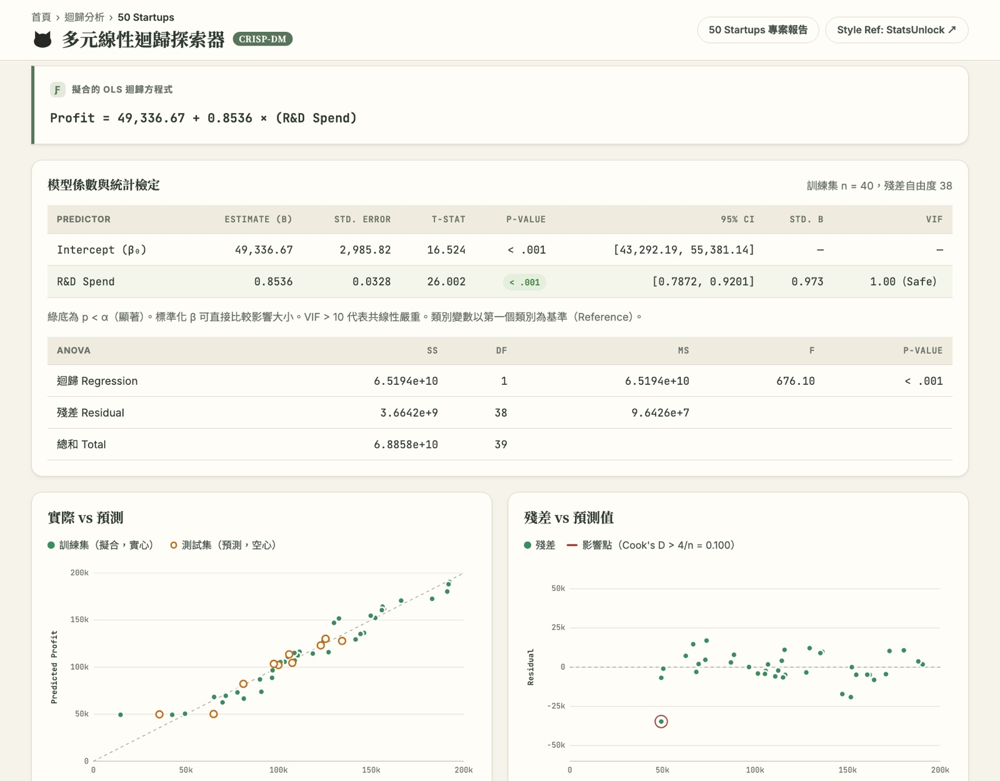
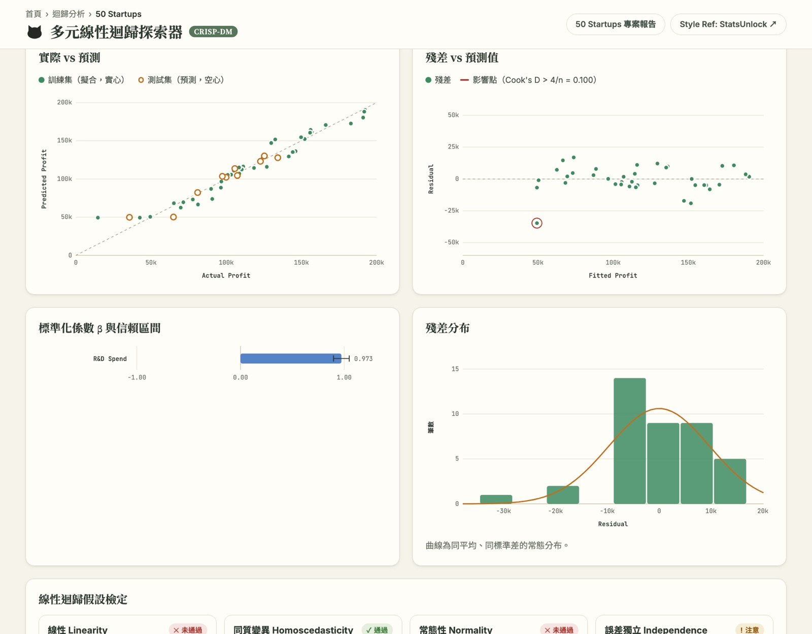
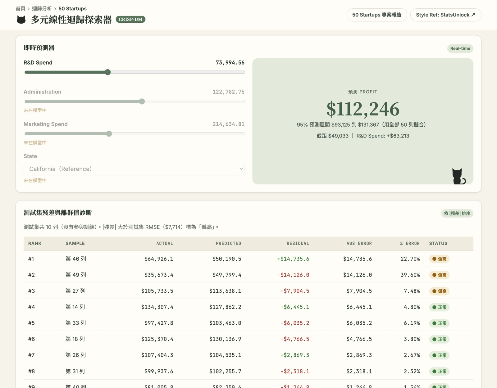
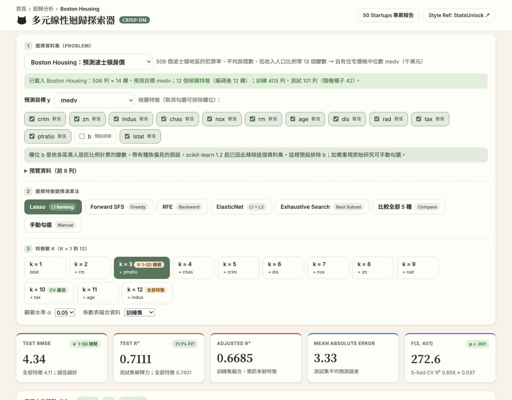

# 50 Startups：多元線性迴歸（CRISP-DM）

用 scikit-learn 解 Kaggle「50 Startups」多元線性迴歸問題：從 R&D、Administration、Marketing 三項支出與所在州別（State），預測新創公司的年度利潤（Profit）。整個專案嚴格依照 **CRISP-DM** 六個階段進行，並提供一份靜態報告，以及一個可切換資料集與演算法、也能輸入任意 CSV 的互動式多元迴歸探索器。

## Demo

| 頁面 | 說明 | Vercel | GitHub Pages |
|---|---|---|---|
| CRISP-DM 專案紀錄 | 靜態報告，逐階段呈現 EDA、特徵選擇、評估與部署結果 | https://aiot-dic-50startup.vercel.app/ | https://taemiyu.github.io/AIOT-DIC-50startup/ |
| 多元線性迴歸探索器 | 互動工具：切換資料集與 5 種特徵選擇演算法、輸入網址或上傳 CSV，即時計算係數、p 值、診斷圖、假設檢定與預測 | https://aiot-dic-50startup.vercel.app/app | https://taemiyu.github.io/AIOT-DIC-50startup/app.html |

兩個網站內容相同，push 到 `main` 後都會自動更新。

- GitHub：https://github.com/taemiyu/AIOT-DIC-50startup

本機預覽：

```bash
python -m http.server 8000
# 開啟 http://localhost:8000/ 與 http://localhost:8000/app.html
```

## 網站截圖

### CRISP-DM 專案報告（[首頁](https://aiot-dic-50startup.vercel.app/)）

逐階段呈現 50 Startups 的資料取得、商業理解、EDA、特徵選擇、建模、評估與部署。


### 多元線性迴歸探索器（[/app](https://aiot-dic-50startup.vercel.app/app)）

**1. 選擇資料集、演算法與特徵數 k**：下拉選單切換資料集；演算法選單有 5 種特徵選擇方法；k 按鈕上的貓掌標示 1-SD 精簡原則選出的 k。下方指標卡片即時更新。


資料集下拉選單：4 個內建資料集（50 Startups、Advertising、Medical Insurance、Boston Housing），以及輸入 CSV 網址、上傳 CSV 檔兩種自訂方式。


**2. 比較全部 5 種演算法**：RMSE／R² 對特徵數的折線圖，以及各演算法的最佳子集比較表。


**3. 迴歸方程式、係數表與 ANOVA**：β、標準誤、t、p 值、信賴區間、標準化 β、VIF。



**4. 診斷圖與假設檢定**：實際 vs 預測（訓練實心、測試空心）、殘差 vs 預測值（紅圈為 Cook's D 影響點）、標準化 β、殘差分布，以及 RESET、Breusch-Pagan、Jarque-Bera、Durbin-Watson、VIF、Cook's D 檢定。



**5. 即時預測器與測試集殘差診斷**：拉動滑桿即時預測，附 95% 預測區間與各項貢獻；下方依 |殘差| 排序列出測試集。



**6. 內建資料集：Boston Housing**：自動判斷欄位型別，欄位 `b` 預設排除並說明原因。



**7. 自訂資料集：輸入 CSV 網址**：以作業範例網址 `https://raw.githubusercontent.com/Avik-Jain/100-Days-Of-ML-Code/master/datasets/50_Startups.csv` 載入。


**8. 自訂資料集：上傳 CSV 檔**：拖曳或點選檔案，只在瀏覽器內讀取。


## 結果摘要

| 項目 | 結果 |
|---|---|
| 最終模型 | `LinearRegression`，只用 **R&D Spend** 一個特徵 |
| 迴歸方程式（以全部 50 筆重新訓練） | Profit ≈ 49,033 + 0.854 × R&D Spend |
| Test R² | **0.9265**（全部 4 個特徵的模型為 0.8987） |
| Test RMSE ／ MAE | $7,714 ／ $6,077 |
| MAPE | 9.14% |
| 5-fold CV R² | 0.937 ± 0.037 |
| 成功標準 | Test R² ≥ 0.90、CV R² ≥ 0.85、MAPE ≤ 10%：**全部通過** |

主要發現：

- **R&D 支出是利潤的主要驅動因素**：與 Profit 的相關係數 r = 0.973，F-score 676，Random Forest 重要度約 93%。研發每多投入 $1，利潤平均多約 $0.85。
- **Administration 與 State 幾乎沒有預測力**：Lasso 會把兩個州別的係數壓到 0，加入它們反而讓測試誤差變大。
- **少即是多**：只用 R&D 的模型在測試集上優於使用全部特徵的模型。
- **限制**：最終模型的 RESET（線性）與 Jarque-Bera（常態）檢定未通過，主要受一筆離群值影響（第 49 筆，Profit $14,681）。樣本只有 50 筆，用於實際決策前應蒐集更多資料。

## CRISP-DM 流程

| 階段 | 內容 |
|---|---|
| 1 Business Understanding | 商業目標、現況評估（資源、限制、風險）、資料探勘目標、事先訂定的成功標準、專案計畫 |
| 2 Data Understanding | 下載資料並比對 SHA-256、敘述統計、相關係數、EDA 圖、缺值／重複／離群值檢查 |
| 3 Data Preparation | 先切分 80/20，再以 `ColumnTransformer` 做 OneHotEncoder（drop first，避開虛擬變數陷阱）與 StandardScaler；特徵選擇分析（Pearson、SelectKBest F-score、RFE、Lasso、Random Forest） |
| 4 Modeling | VIF 共線性檢查；4 個特徵的全部 15 種組合以 5-fold CV 比較，依 1-SD 精簡原則選模型；比較 5 種特徵選擇演算法 |
| 5 Evaluation | 測試集指標、殘差診斷、對照成功標準、流程審查、決定下一步 |
| 6 Deployment | 通過評估才以全部資料重新訓練，並用 joblib 儲存；監控計畫與最終報告 |

### 避免資料洩漏

- 所有前處理都包在 `Pipeline` 裡，只在訓練集上 fit。
- 特徵選擇只用訓練集的交叉驗證，測試集只用來回報最終結果。
- 常見範例會直接用測試集 RMSE 挑特徵，本專案刻意不這樣做，所以 forward selection 第 2 步選到的特徵可能和那些範例不同。

### 5 種特徵選擇演算法

| 檔名前綴 | 演算法 |
|---|---|
| `lasso_l1_ranking` | Lasso 路徑上特徵進入的順序 |
| `forward_sfs` | `SequentialFeatureSelector`（forward） |
| `rfe` | Recursive Feature Elimination |
| `elasticnet_ranking` | ElasticNet 路徑上特徵進入的順序（l1_ratio = 0.5） |
| `exhaustive_search` | 每個特徵數下的最佳子集 |

每種演算法都只看訓練集，以 5-fold CV RMSE 決定特徵，並記錄用 1 到 5 個特徵時的測試集 RMSE 與 R²。

## 多元線性迴歸探索器（app.html）

所有計算都在瀏覽器裡完成，不需要後端。

### 1. 選擇資料集（下拉選單）

| 選項 | 預測目標 | 說明 |
|---|---|---|
| 50 Startups | Profit | 本作業資料集，訓練／測試切分與 `main.py` 完全相同 |
| Advertising | sales | ISLR 教科書：電視、廣播、報紙廣告預算 → 銷售量（200 筆） |
| Medical Insurance | charges | 年齡、性別、BMI、子女數、吸菸、地區 → 醫療保險費（1,338 筆，含 3 個類別欄位） |
| Boston Housing | medv | 犯罪率、平均房間數、低收入人口比例等 13 個變數 → 房價中位數（506 筆）。欄位 `b` 依各區黑人居民比例計算、帶有種族偏見的假設（scikit-learn 1.2 起已因此移除此資料集），預設排除，可手動勾選 |
| 自訂：輸入 CSV 網址 | 自選 | 例如 `https://raw.githubusercontent.com/Avik-Jain/100-Days-Of-ML-Code/master/datasets/50_Startups.csv`；GitHub 頁面網址會自動轉成 raw |
| 自訂：上傳 CSV 檔 | 自選 | 拖曳或選擇檔案，只在瀏覽器內讀取，不會上傳到伺服器 |

載入任意 CSV 時會自動：判斷數值／類別欄位、排除流水號與 ID 欄位、對類別欄位做 One-Hot 編碼（捨棄第一個類別當基準）、排除有缺值的列，再以固定種子 42 做 80/20 切分與 5-fold CV。可以改選預測目標，或取消勾選不想納入的欄位。

### 2. 選擇特徵選擇演算法（選單）

Lasso、Forward SFS、RFE、ElasticNet、Exhaustive Search，另有「比較全部 5 種」與「手動勾選」。

### 3. 選擇特徵數 k

k = 1 到 p。預設採 **1-SD 精簡原則**：在 CV RMSE 與最佳值相差不到一個標準差的 k 中，選特徵最少的。在 50 Startups 上，這會選出只用 R&D Spend 的模型，和 `main.py` 的最終模型一致。

### 輸出

- 指標卡片：Test RMSE、Test R²、Adjusted R²、MAE、F 統計量（與全部特徵模型比較）
- RMSE／R² 對特徵數的折線圖，以及 5 種演算法比較表
- 迴歸方程式、係數表（β、SE、t、p 值、信賴區間、標準化 β、VIF）、ANOVA
- 診斷圖：實際 vs 預測、殘差 vs 預測值（標出 Cook's D 影響點）、標準化 β、殘差分布
- 假設檢定：Ramsey RESET、Breusch-Pagan、Jarque-Bera、Durbin-Watson、VIF、Cook's D
- 即時預測器（95% 預測區間、各項貢獻、外插警示）
- 測試集殘差排行與離群值診斷、結果解讀、APA 7 報告段落

### 驗證

- `regression.js` 的所有統計量都已和 numpy／scipy／scikit-learn 逐項比對（最大相對誤差約 1e-12）。
- `selection.js` 的 5 種演算法在 50 Startups 上，k = 1～5 共 25 組選到的特徵都與 `feature_progression_analysis.py` 完全相同。

## 專案結構

```
main.py                              CRISP-DM 六階段主程式
feature_progression_analysis.py      5 種特徵選擇演算法 × 1～5 個特徵
regression.js                        瀏覽器端 OLS 統計引擎
selection.js                         瀏覽器端 CSV 解析、編碼、切分與 5 種特徵選擇演算法
index.html                           50 Startups 靜態報告
app.html                             多元線性迴歸探索器
datasets/                            內建資料集：Advertising.csv、insurance.csv、BostonHousing.csv
model_data.json / model_data.js      main.py 產生的網頁資料
50_Startups.csv                      資料集（沒有時 main.py 會自動下載並驗證）
requirements.txt                     Python 套件版本
vercel.json                          Vercel 靜態網站設定

{method}_progression.csv             各演算法逐步結果
{method}_plot.png                    各演算法的 RMSE／R² 對特徵數圖
all_5_algorithms_comparison_plot.png 5 種演算法的 Test RMSE 比較
feature_selection_comparison.csv/png 各演算法最佳子集比較
docs/screenshots/                    README 用的網站截圖
crispdm_output/                      各階段圖表、部署模型（.joblib）、final_report.json
```

## 執行

需要 Python 3.10 以上。

```bash
python3 -m venv .venv
source .venv/bin/activate
pip install -r requirements.txt
python main.py
```

`main.py` 會依序跑完六個階段，並產生上面所有的輸出檔與網頁資料。只想重跑特徵選擇比較：

```bash
python feature_progression_analysis.py
```

## 部署

網頁都是靜態檔案，不需要安裝或建置步驟（設定在 `vercel.json`）。本專案已透過 Vercel 匯入 GitHub repo 部署，每次 push 到 `main` 都會自動重新部署。

自行部署：在 Vercel 匯入此 repo，Application Preset 選 **Other**，Build Command 與 Install Command 設為 `echo skip`，其他維持預設。

同時也以 **GitHub Pages** 發布（Settings → Pages → Deploy from a branch → `main` / `(root)`）。根目錄的 `.nojekyll` 讓 GitHub 不經 Jekyll 處理，檔案原樣發布。GitHub Pages 沒有 clean URL，探索器網址需加 `.html`。

## 致謝與參考資料

- **資料集**：[50 Startups](https://www.kaggle.com/code/akash17/50-startups-linearregression)（Kaggle）。程式從 [krishnaik06/Multiple-Linear-Regression](https://github.com/krishnaik06/Multiple-Linear-Regression) 的公開副本下載，並比對 SHA-256 確認與其他獨立副本一致。
- **版面參考**：[AIoT-DIC2 Multiple LR Explorer](https://huanchen1107.github.io/AIoT-DIC2-MultipleLR/)。網站的排版（麵包屑標題列、主視覺卡片、演算法與特徵數分段按鈕、指標卡片、測試集殘差表）參考了這個網站。
- **統計計算機風格**：[StatsUnlock — Multiple Linear Regression Calculator](https://statsunlock.com/multiple-linear-regression-calculator/)。完整係數表、ANOVA、診斷圖、假設檢定徽章、結果解讀與 APA 報告段落參考了這個網站。
- **其他資料集**：Advertising 取自 [*An Introduction to Statistical Learning*](https://www.statlearning.com/)（James, Witten, Hastie & Tibshirani）；Medical Insurance 取自 [stedy/Machine-Learning-with-R-datasets](https://github.com/stedy/Machine-Learning-with-R-datasets)；Boston Housing 原始研究為 Harrison, D. & Rubinfeld, D. L. (1978), *Hedonic prices and the demand for clean air*，檔案取自 [selva86/datasets](https://github.com/selva86/datasets)。作業範例網址的 50 Startups 副本來自 [Avik-Jain/100-Days-Of-ML-Code](https://github.com/Avik-Jain/100-Days-Of-ML-Code)。
- **方法論**：Chapman, P. et al. (2000). *CRISP-DM 1.0: Step-by-step data mining guide*.
- **套件**：[scikit-learn](https://scikit-learn.org/)、[pandas](https://pandas.pydata.org/)、[NumPy](https://numpy.org/)、[SciPy](https://scipy.org/)、[Matplotlib](https://matplotlib.org/)、[joblib](https://joblib.readthedocs.io/)、[Requests](https://requests.readthedocs.io/)
- **字型**：[Google Fonts](https://fonts.google.com/)：Noto Serif TC（標題）、Inter、Noto Sans TC、JetBrains Mono
