# AIoT HW2：WHO 平均壽命多元線性迴歸（CRISP-DM）

以 Kaggle「**Life Expectancy (WHO)**」資料集（193 國、2000–2015 年、20 個候選特徵），依 **CRISP-DM** 六階段建立多元線性迴歸模型：資料清理、特徵選擇、模型評估，並提供含 **95% 信賴區間與預測區間** 的預測圖。網站另附一個互動式多元迴歸探索器，可切換資料集與特徵選擇演算法，也能輸入任意 CSV。

## Demo

| 頁面 | 說明 | Vercel | GitHub Pages |
|---|---|---|---|
| HW2 專案報告 | CRISP-DM 六階段完整報告 | https://aiot-hw2-multiple-linear-regression.vercel.app/ | https://taemiyu.github.io/AIOT-HW2-Multiple_Linear_regression/ |
| 多元迴歸探索器 | 切換資料集／演算法、輸入網址或上傳 CSV，即時計算 | https://aiot-hw2-multiple-linear-regression.vercel.app/app | https://taemiyu.github.io/AIOT-HW2-Multiple_Linear_regression/app.html |

兩個網站內容相同，push 到 `main` 後都會自動更新。

- GitHub：https://github.com/taemiyu/AIOT-HW2-Multiple_Linear_regression

## 網站截圖

### HW2 專案報告

依 CRISP-DM 六階段呈現：資料來源、商業理解、資料理解、資料準備、建模、評估、部署，最後是 AI 輔助說明與 NotebookLM 摘要。

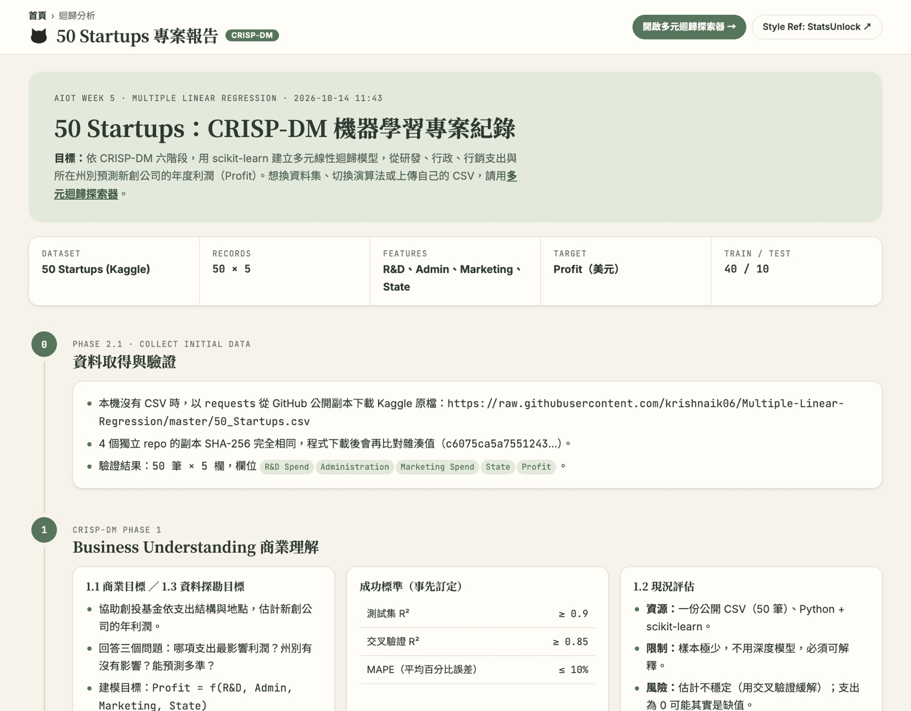

**資料理解**：各欄缺值數、與平均壽命的相關係數、平均壽命分布、不合理數值與處理方式。

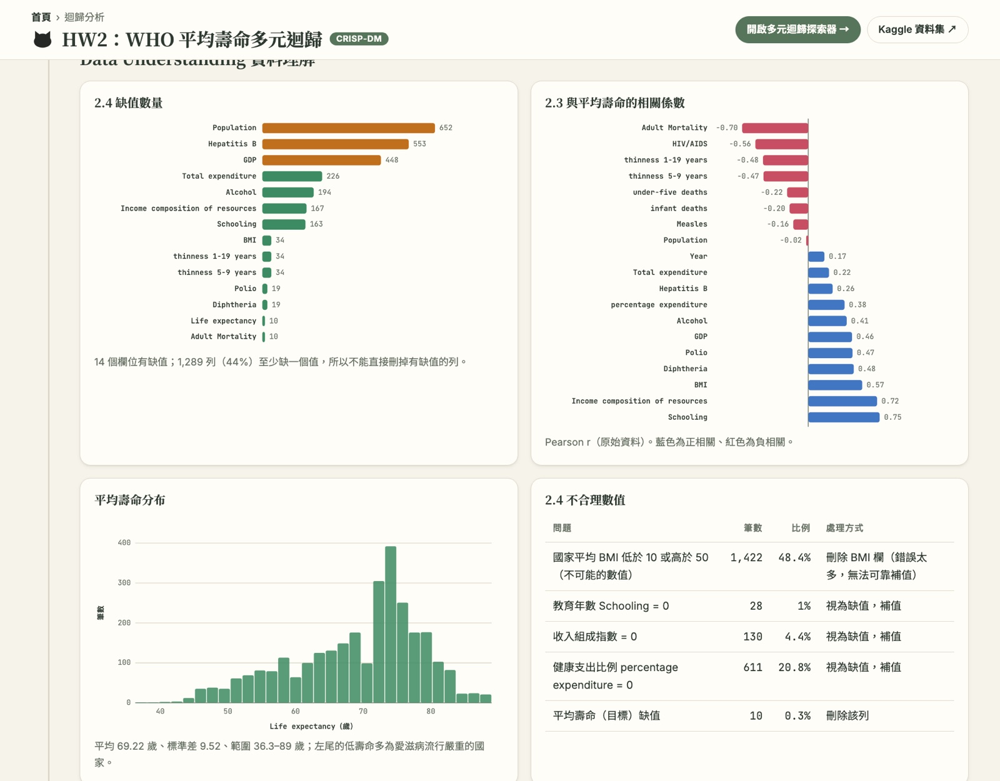

**特徵選擇**：全部候選特徵的 VIF（嬰兒與五歲以下死亡數嚴重共線），4 種演算法的 Test RMSE 對特徵數，以及各演算法的 1-SD 精簡子集。

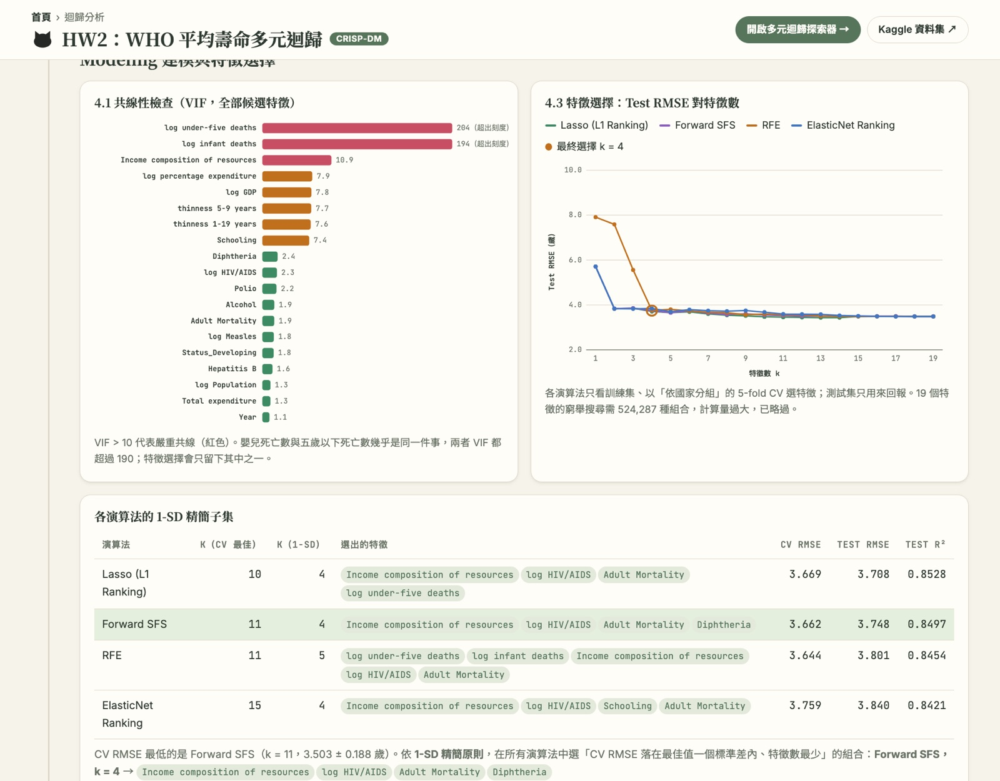

**模型比較與最終模型**：OLS（全部／精簡）、Ridge、Lasso 的比較；最終模型的迴歸方程式與係數表（含依國家分群的叢集穩健標準誤）。

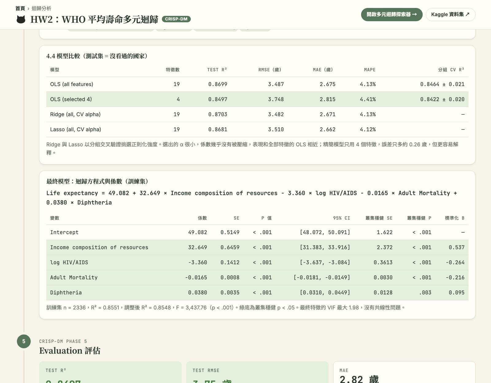

**預測圖（作業指定）**：測試集 37 個沒看過的國家，附 95% 信賴區間與預測區間；下方為單純線性迴歸的區間圖。

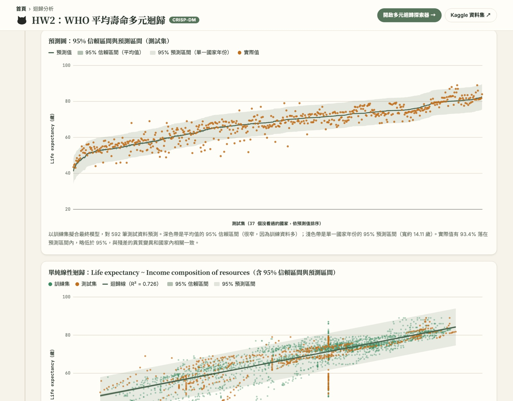

### 多元迴歸探索器

**總覽**：資料集下拉選單（預設 WHO，與 Python 相同的依國家切分）、演算法選單、特徵數 k、指標卡片。

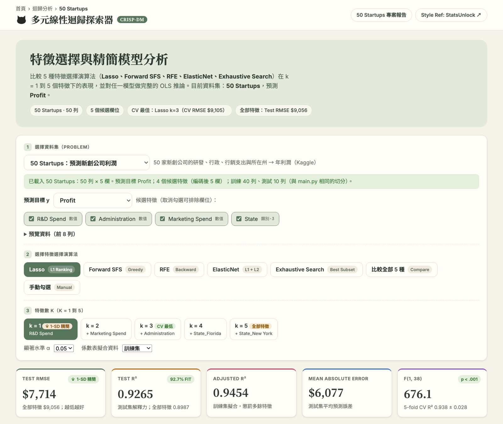

**比較全部演算法**：RMSE／R² 對特徵數的折線圖與比較表。

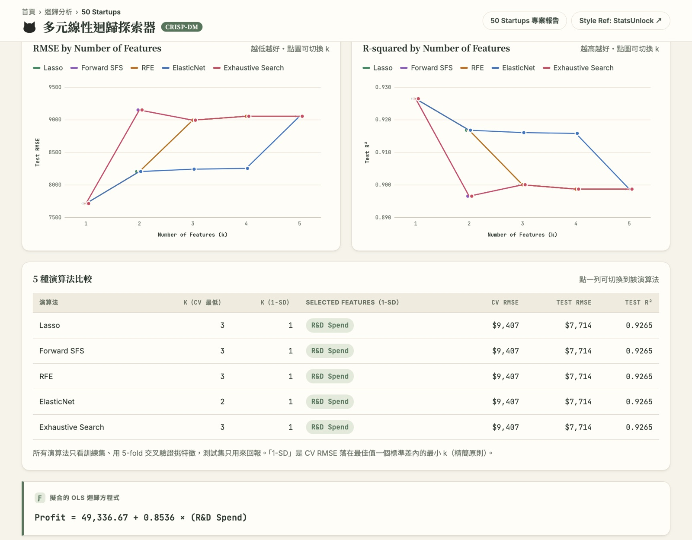

**預測圖**：依目前選的特徵即時重算測試集預測值、信賴區間與預測區間，並顯示涵蓋率；下方為假設檢定。

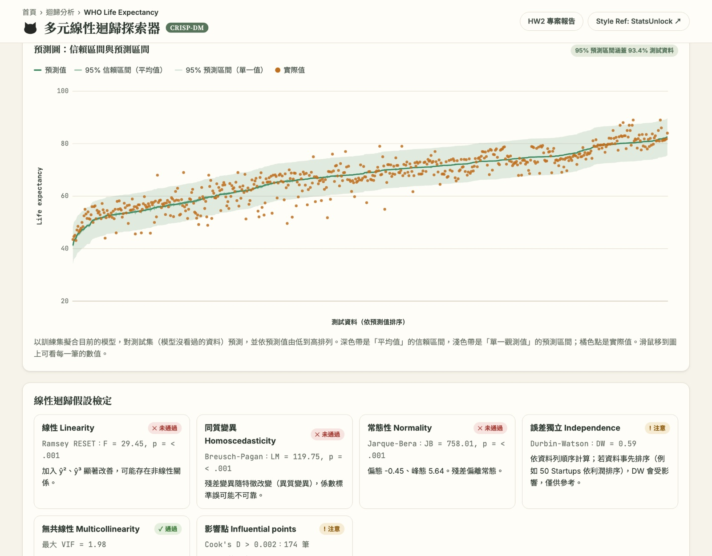

**第二個 Kaggle 資料集**：下拉選單的「Predict the Flood」（[Kaggle Playground Series S4E5](https://www.kaggle.com/competitions/playground-series-s4e5)），以 20 個因子評分預測洪水發生機率。原始訓練資料有 1,117,957 列，超過瀏覽器端上限，因此以隨機種子 42 抽樣 5,000 列存成 `datasets/flood.csv`；全部 20 個特徵的 OLS 測試集 R² 約 0.84。

**加分：任意輸入資料集**：輸入 CSV 網址（作業範例網址）或上傳 CSV 檔。

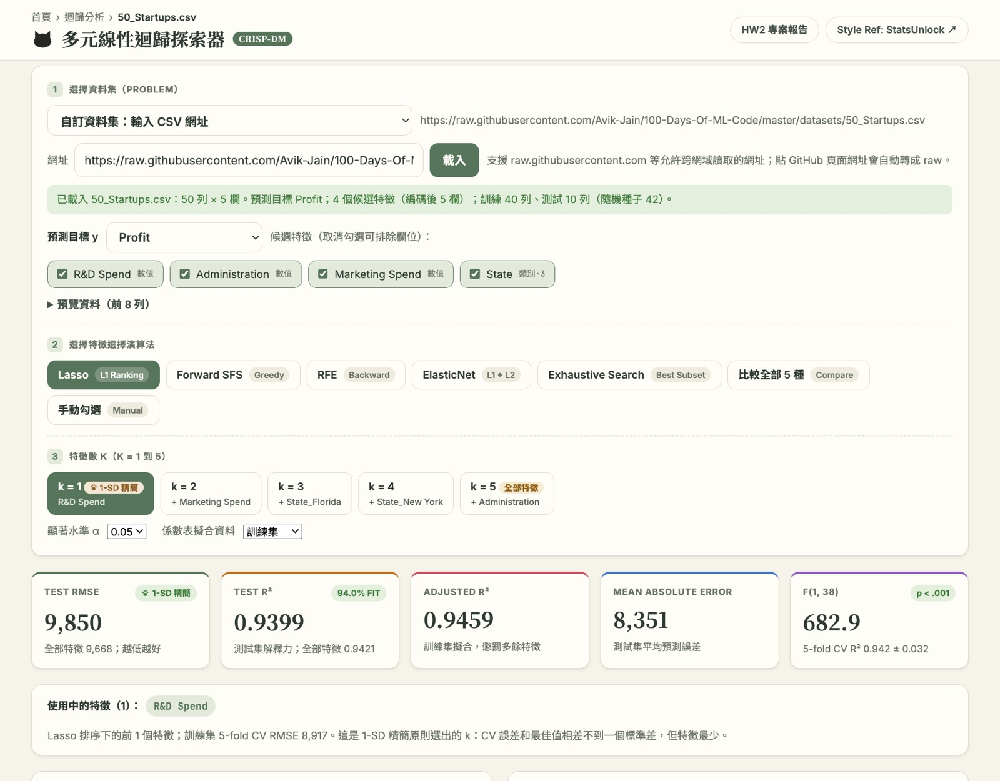

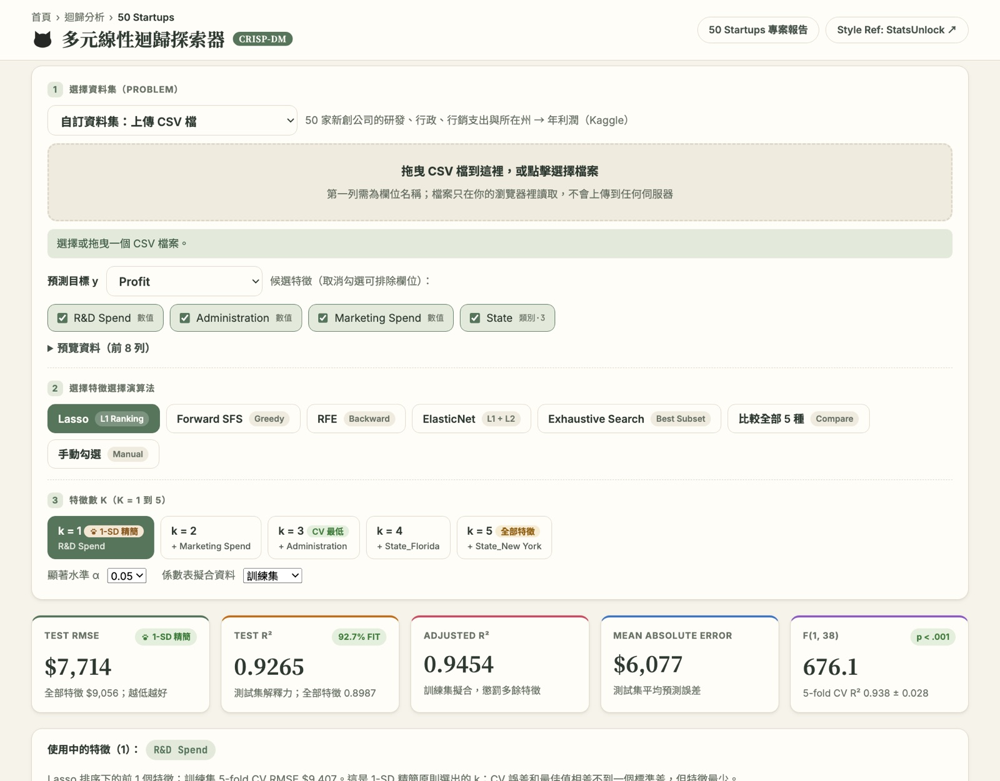

## 報告書與資訊圖表

| 項目 | 檔案 | 線上瀏覽 |
|---|---|---|
| 報告書（PDF，17 頁） | [docs/HW2_report.pdf](docs/HW2_report.pdf) | https://aiot-hw2-multiple-linear-regression.vercel.app/docs/report |
| 資訊圖表 | [docs/infographic.png](docs/infographic.png)、[docs/infographic.pdf](docs/infographic.pdf) | https://aiot-hw2-multiple-linear-regression.vercel.app/docs/infographic |

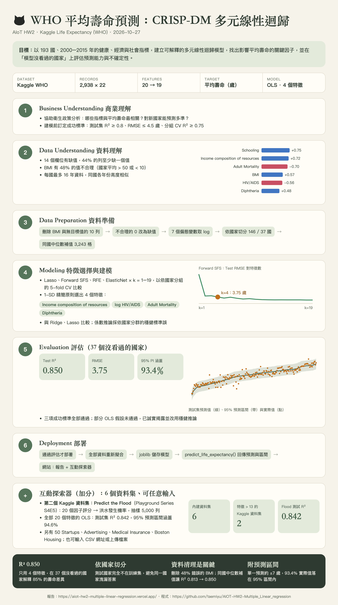

兩者由 `docs/build_docs.py` 依 `model_data.json` 自動產生（需安裝 Google Chrome）：

```bash
python docs/build_docs.py
```

## 作業要求對照

| 要求 | 本專案的對應內容 |
|---|---|
| Kaggle 資料集，特徵數 > 13，標示來源與連結 | [Life Expectancy (WHO)](https://www.kaggle.com/datasets/kumarajarshi/life-expectancy-who)：20 個候選特徵，資料處理後 19 個 |
| 線性迴歸（單純／多元） | 多元線性迴歸（OLS）；另附單純線性迴歸（Income composition of resources）比較 |
| 特徵選擇 | Lasso、Forward SFS、RFE、ElasticNet 四種演算法 × k = 1～19，以依國家分組的交叉驗證 + 1-SD 精簡原則選模型 |
| 模型評估 | 測試集為 37 個「沒看過的國家」：R²、RMSE、MAE、MAPE、分組 CV R²；與 Ridge／Lasso 比較；五大迴歸假設檢定 |
| 預測圖加信賴區間或預測區間 | `crispdm_output/07_prediction_intervals_test.png`、`08_simple_regression_intervals.png`；網頁報告與探索器也有互動版 |
| CRISP-DM 六階段 | `main.py` 依六階段撰寫；網頁報告逐階段呈現 |
| 選做：資訊圖表、報告書 | `docs/infographic.png`、`docs/infographic.pdf`、`docs/HW2_report.pdf` |
| GPT 輔助內容、NotebookLM 摘要 | 網頁報告最後兩節：使用的 AI 工具（Claude、NotebookLM）與分工、NotebookLM 摘要與來源 |
| 加分：下拉選單呈現兩種以上 problem | 探索器內建 6 個資料集，其中兩個是特徵數 > 13 的 Kaggle 資料集：WHO Life Expectancy（20 個特徵）與 [Predict the Flood](https://www.kaggle.com/competitions/playground-series-s4e5)（20 個特徵）；另有 50 Startups、Advertising、Medical Insurance、Boston Housing |
| 加分：可任意輸入 Dataset | 探索器可輸入 CSV 網址或上傳 CSV 檔 |

## 結果摘要

| 項目 | 結果 |
|---|---|
| 最終模型 | OLS，4 個特徵：Income composition of resources、log HIV/AIDS、Adult Mortality、Diphtheria |
| 測試集（37 個沒看過的國家） | R² **0.850**、RMSE **3.75 歲**、MAE 2.82 歲、MAPE 4.41% |
| 分組 5-fold CV R² | 0.842 ± 0.020 |
| 只猜平均的基準 | RMSE 9.95 歲 |
| 95% 預測區間涵蓋率 | 93.4%（單一預測約 ±7 歲） |
| 全部 19 個特徵的 OLS | R² 0.870、RMSE 3.49 歲（多 15 個特徵，只少約 0.26 歲誤差） |
| 成功標準 | 測試集 R² ≥ 0.80、RMSE ≤ 4.5 歲、分組 CV R² ≥ 0.75：**全部通過** |

主要發現：

- **收入組成指數（Income composition of resources）是最強的指標**（標準化 β = 0.54），其次是愛滋病盛行率（−0.26）與成人死亡率（−0.22）。
- **依國家切分很重要**：同一國家各年份非常相似，隨機切分會讓同一國家同時出現在訓練與測試集而高估分數。本專案的測試集國家完全不在訓練集中。
- **資料清理影響很大**：BMI 欄有 48% 的值不合理而刪除；缺值先用同一國家其他年份的中位數補，讓測試集 R² 從 0.813 提升到 0.850。
- **限制**：殘差有異質變異、非常態，且同一國家內的誤差高度相關（Durbin-Watson 0.57），因此係數推論改用依國家分群的叢集穩健標準誤。相關不代表因果。

## CRISP-DM 流程

| 階段 | 內容 |
|---|---|
| 1 Business Understanding | 商業目標、三個商業問題、現況評估（資源、限制、風險）、建模前訂定的成功標準、專案計畫 |
| 2 Data Understanding | 敘述統計、缺值（14 欄、44% 的列）、不合理值（BMI、0 值）、與目標的相關、目標分布、偏態 |
| 3 Data Preparation | 刪除無目標值的 10 列與 BMI 欄；不合理的 0 改為缺值；7 個偏態變數取 log；Status 轉 0/1；**依國家** 80/20 切分；補值（同國中位數，再用訓練集中位數） |
| 4 Modeling | VIF 共線性檢查；4 種特徵選擇演算法 × k = 1～19；1-SD 精簡原則；與 Ridge、Lasso 比較；statsmodels OLS 推論（含叢集穩健標準誤） |
| 5 Evaluation | 測試集指標、預測區間圖、殘差診斷、RESET／Breusch-Pagan／Jarque-Bera／Durbin-Watson／VIF／Cook's D、成功標準、流程審查 |
| 6 Deployment | 通過評估才以全部資料重新擬合並儲存；`predict_life_expectancy()` 接受原始欄位、回傳預測值與區間；監控計畫 |

## 專案結構

```
main.py                              CRISP-DM 六階段主程式
feature_progression_analysis.py      特徵選擇演算法 × k = 1～p
datasets/LifeExpectancy_WHO.csv      Kaggle 原始資料
datasets/who_prepared.csv            main.py 清理與補值後的資料（網頁使用）
datasets/flood.csv                   Predict the Flood（Kaggle）抽樣 5,000 列
datasets/                            探索器的其他內建資料集
index.html                           HW2 專案報告（網頁）
app.html                             多元迴歸探索器
regression.js / selection.js         瀏覽器端 OLS 統計與特徵選擇（與 Python 結果一致）
model_data.json / model_data.js      main.py 產生的網頁資料
crispdm_output/                      各階段圖表、模型（.joblib）、final_report.json、執行紀錄
*_progression.csv / *_plot.png       各特徵選擇演算法的逐步結果
requirements.txt                     Python 套件版本
docs/screenshots/                    README 用的網站截圖
docs/HW2_report.pdf、report.html       報告書（PDF 與網頁版）
docs/infographic.png／.pdf／.html   資訊圖表
docs/build_docs.py                   產生報告書與資訊圖表
```

## 執行

```bash
python3 -m venv .venv
source .venv/bin/activate
pip install -r requirements.txt
python main.py
```

資料檔已包含在 `datasets/`。若要自行下載：到 [Kaggle](https://www.kaggle.com/datasets/kumarajarshi/life-expectancy-who) 下載 `Life Expectancy Data.csv`，存成 `datasets/LifeExpectancy_WHO.csv`。

本機預覽網頁：

```bash
python3 -m http.server 8000
# 開啟 http://localhost:8000/ 與 http://localhost:8000/app.html
```

## AI 協助說明

本專案使用 **Claude（Claude Code）** 作為主要開發工具（程式、分析、網頁與報告草稿），並使用 **NotebookLM** 研究同主題解法。AI 協助範圍與本人負責的部分詳列於網頁報告的「GPT 輔助內容」一節，對話紀錄另以 PDF 直接繳交（不放在本 repo）；NotebookLM 研究摘要與來源放在報告的「NotebookLM 摘要」一節。

## 致謝與參考資料

- **資料集**：[Life Expectancy (WHO)](https://www.kaggle.com/datasets/kumarajarshi/life-expectancy-who)，Kaggle，KumarRajarshi；原始資料來自 WHO Global Health Observatory 與聯合國。
- **版面參考**：[AIoT-DIC2 Multiple LR Explorer](https://huanchen1107.github.io/AIoT-DIC2-MultipleLR/)
- **統計計算機風格**：[StatsUnlock — Multiple Linear Regression Calculator](https://statsunlock.com/multiple-linear-regression-calculator/)
- **第二個 Kaggle 資料集**：[Predict the Flood](https://www.kaggle.com/competitions/playground-series-s4e5)，Kaggle Playground Series Season 4 Episode 5（2024），以 Flood Prediction Factors 資料集為基礎產生的合成資料；本專案只使用其中隨機抽樣的 5,000 列。
- **探索器的其他資料集**：50 Startups（Kaggle）、Advertising（[ISLR](https://www.statlearning.com/)）、Medical Insurance（[stedy/Machine-Learning-with-R-datasets](https://github.com/stedy/Machine-Learning-with-R-datasets)）、Boston Housing（Harrison & Rubinfeld, 1978；[selva86/datasets](https://github.com/selva86/datasets)）
- **方法論**：Chapman, P. et al. (2000). *CRISP-DM 1.0: Step-by-step data mining guide*.
- **套件**：scikit-learn、statsmodels、SciPy、pandas、NumPy、Matplotlib、joblib
